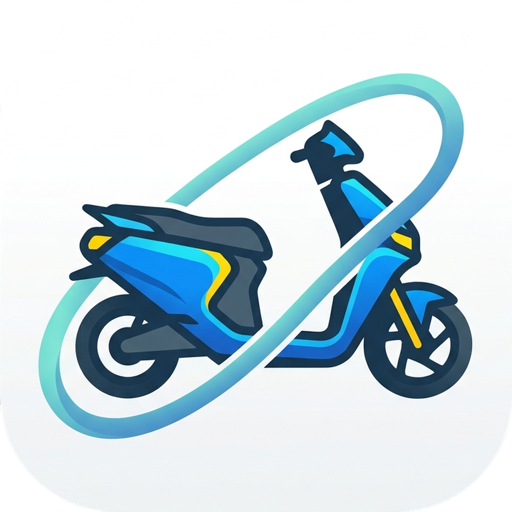
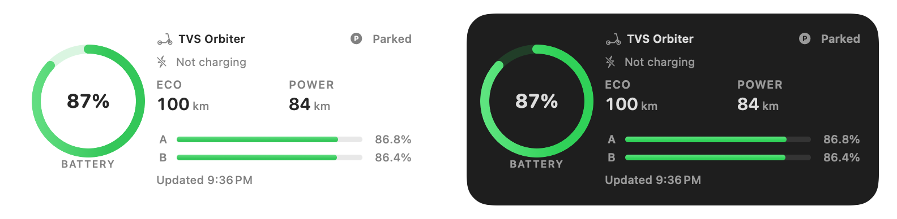
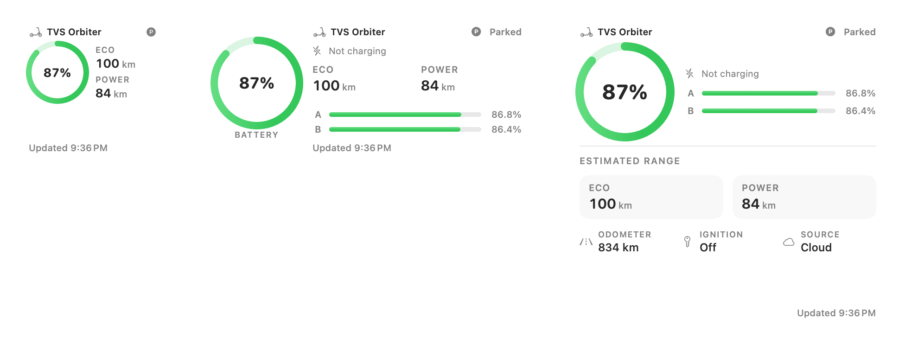
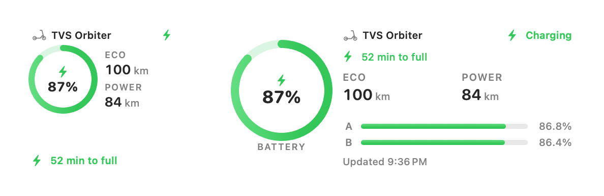
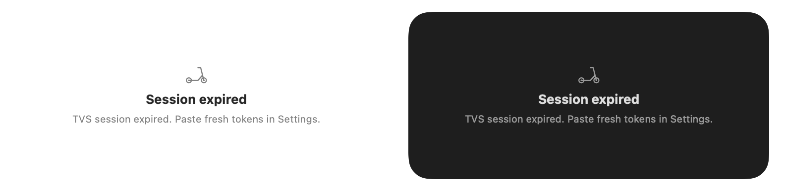

  <picture>
    <source media="(prefers-color-scheme: dark)" srcset="assets/logo-dark.png">
    
  </picture>

<h1 align="center">iQube Companion</h1>

  Your TVS electric scooter's battery, charging status and range on your Mac desktop.

  

---

## About

iQube Companion is a native macOS menu-bar app with a desktop widget for TVS electric scooters. It shows
the same information as the official TVS Connect phone app, so you can check your scooter without
reaching for your phone.

- **Battery:** overall state of charge, plus each battery pack (A and B) separately.
- **Estimated range:** for each riding mode your scooter reports, such as Eco and Power.
- **Charging:** whether the scooter is charging, the estimated time to full, and a reminder to unplug when it's full.
- **Status:** Parked, Ignition on, Charging, or Asleep, plus odometer and the time of the last update.
- **Live updates:** while the scooter is online it sends a new reading about every 5 seconds. When it is parked and asleep, the app falls back to the last reading stored by TVS.
- **Native look:** built with SwiftUI and WidgetKit, it follows macOS light and dark appearance automatically.
- **Three sizes:** Small, Medium and Large.

## Screenshots

### Widget sizes

<picture>
  <source media="(prefers-color-scheme: dark)" srcset="assets/sizes-dark.png">
  
</picture>

### Charging

### Signed out or session expired

The screenshots show real readings from a TVS Orbiter. In the charging screenshot, the 52-minute "time to full" is an example value.

## Requirements

- macOS 14 Sonoma or later (Apple silicon or Intel)
- A TVS electric scooter with connected features (tested on a TVS Orbiter; the iQube uses the same data fields)
- An active TVS Connect account that your scooter is registered to

## How to use

### 1. Install

1. Download the latest `iQube-Companion.dmg` from the [Releases](../../releases) page.
2. Open the DMG and drag **iQube Companion** into your **Applications** folder.
3. Open it from Applications. A scooter icon with your battery percentage appears in the menu bar.
   There is no Dock icon; the app lives in the menu bar.

### 2. Connect your TVS account

1. Click the scooter icon in the menu bar, then **Settings**.
2. Under **TVS session**, enter your session details and click **Save session**.
3. The menu-bar icon switches to your battery percentage within a few seconds.

Your session details are stored only in your Mac's Keychain. See [Privacy](#privacy) below.

### 3. Add the widget

1. Right-click an empty part of your desktop and choose **Edit Widgets**.
2. Search for **TVS Scooter**.
3. Drag the Small, Medium or Large size onto your desktop or into Notification Center, then click **Done**.

### 4. Keep it updating

The widget only updates while the menu-bar app is running. In **Settings**, turn on **Launch at login**
so it starts automatically after a restart.

### Reading the widget

| Indicator | Meaning |
|---|---|
| **Parked** | The scooter is online, ignition is off and it's not charging. |
| **Ignition on** | The scooter is switched on. |
| **Charging** | The scooter is plugged in. The time to full is shown when the scooter reports one. |
| **Fully charged** | Charging is complete; you can unplug. |
| **Asleep**, with "Last seen" in orange | No new reading for more than 30 minutes. This is normal when the scooter has been parked for a while; the widget shows the last known values. |
| **Session expired** | Your TVS session has ended. Enter fresh session details in Settings. |

## Privacy

- **Session storage:** your TVS session is stored only in the macOS Keychain on your Mac. It is never written to a file or logged.
- **Network:** the app talks only to TVS's own servers (`tvsiqubeapi.tvsmotor.com` and `p360.tvsmotor.com`). There is no analytics, no tracking, and no server operated by this project.
- **The widget:** it has no network access. It runs sandboxed and can only read the latest reading saved by the app.
- **Location:** location data received from TVS is never stored or displayed.
- **Removing everything:** click **Sign out** in Settings to delete your session. To remove the app, quit it from the menu bar, delete it from Applications, and delete `~/Library/Application Support/TVSConnectWidget`.

## Troubleshooting

**The widget says "Not connected" or "Session expired."**
Open **Settings** from the menu-bar icon and save your session details again.

**The widget shows old values.**
- Check that the menu-bar app is running (the scooter icon is visible).
- Your scooter may be asleep; it reports again once you switch it on or start charging.
- Click **Reconnect** in the menu-bar panel to force a refresh.

**macOS asks to allow Keychain access after an update.**
Click **Always Allow**. The app is asking for its own saved session.

**The widget does not appear in Edit Widgets.**
Open the app from Applications at least once, then reopen Edit Widgets.

## Disclaimer

iQube Companion is an independent, unofficial project. It is not affiliated with, endorsed by, or
supported by TVS Motor Company. "TVS", "iQube", "Orbiter" and "TVS Connect" are trademarks of their
respective owners and are used here only to describe compatibility.

The app relies on the same services as the official TVS Connect app. TVS may change those services at
any time, which could stop the app from working. Use it only with your own account and your own
vehicle. The software is provided as-is, without warranty of any kind.
